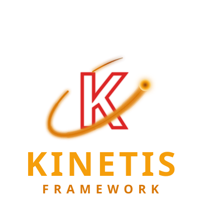

<p align="center">
  
</p>

<p align="center">
  <strong>kinetis/neuron</strong>
  <br>
  <strong>Neuron AI providers over a non-blocking, bounded HTTP client</strong>
</p>

<p align="center">
  <a href="https://packagist.org/packages/kinetis/neuron"></a>
  <a href="https://packagist.org/packages/kinetis/neuron"></a>
  <a href="https://packagist.org/packages/kinetis/neuron"></a>
  <a href="https://packagist.org/packages/kinetis/neuron"></a>
  <a href="https://github.com/kinetis-dev/kinetis/actions/workflows/ci.yml"></a>
</p>

---

Part of [Kinetis](https://kinetis.dev/), a non-blocking PHP framework for
API-first applications, developed in the
[kinetis-dev/kinetis](https://github.com/kinetis-dev/kinetis) monorepo.

`Kinetis\Neuron\NeuronHttpClient` implements
[Neuron AI](https://github.com/neuron-core/neuron-ai)'s
`NeuronAI\HttpClient\HttpClientInterface` over
[`kinetis/revolt-http-client`](https://github.com/kinetis-dev/revolt-http-client).
A provider call suspends the calling Fiber instead of blocking the
process, has one deadline and one byte ceiling, and can reach only the
provider's origin.

```php
use Kinetis\Neuron\NeuronHttpClient;
use Kinetis\RevoltHttpClient\Http;
use NeuronAI\Providers\OpenAI\OpenAI;

$client = new NeuronHttpClient(
    new Http()->withTimeout(120)->withMaxResponseBytes(4 * 1024 * 1024),
    'https://api.openai.com/v1',
);

$provider = new OpenAI(key: $apiKey, model: 'gpt-4.1-mini', httpClient: $client);
```

The second argument is the provider's own base URI. An absolute URI
outside it is refused before anything is sent. The client is immutable
and holds no request data, so one instance can serve every request of a
persistent worker. Build the provider and the `Agent` per request: both
hold request data.

`Kinetis\Neuron\McpTools` gives an agent the application's own
`#[McpTool]` tools, called in process with the current request's scope,
validated by the MCP dispatcher, and published to the provider with
their MCP input schema unchanged:

```php
$agent->addTool($mcpTools->select('find_orders', 'cancel_order'));
```

`Kinetis\Neuron\AgentStream` streams an agent run to the browser in
Neuron's Vercel AI SDK or AG-UI protocol, one flushed Server-Sent Event
per protocol event, under FrankenPHP or PHP-FPM. `$connection` is the
request's `Kinetis\Runtime\ClientConnectionInterface`, injected into the
controller:

```php
$adapter = new VercelAIAdapter();
$run = $agent->setStreamAdapter(static fn (): VercelAIAdapter => $adapter)->stream(new UserMessage($question));

return new AgentStream($adapter, $connection)->response($run);
```

`Kinetis\Neuron\InferenceTelemetry` reports every provider call of an
agent through the framework's instrumentation hooks; with
[`kinetis/telemetry`](https://github.com/kinetis-dev/telemetry) each
becomes a span carrying the provider, the model and the token usage,
never the prompt or the answer:

```php
$agent = InferenceTelemetry::observe(Agent::make())->setAiProvider($provider);
```

The same client carries Neuron's `McpConnector` to a remote MCP server
over Streamable HTTP, pinned to the server's origin and bounded by its
byte ceiling. Build the connector per request unless its credentials are
the application's own
([guide](https://kinetis.dev/docs/neuron.html#neuron-remote-mcp)):

```php
$connector = new McpConnector(
    ['url' => 'https://tools.example.com/mcp', 'token' => $serviceToken],
    new NeuronHttpClient(new Http(), 'https://tools.example.com'),
);
$agent->addTool($connector->tools());
```

Neuron's HTTP vector stores (Chroma, Meilisearch, Pinecone, Qdrant,
Weaviate) and its embeddings providers, except AWS Bedrock's, take the
same client. Pin it at the vector database's origin, not at the collection
([guide](https://kinetis.dev/docs/neuron.html#neuron-vector-stores)):

```php
$store = new QdrantVectorStore(
    'http://qdrant:6333/collections/articles',
    httpClient: new NeuronHttpClient(new Http(), 'http://qdrant:6333'),
);
```

Neuron's Amazon Bedrock classes send through aws-sdk-php, which blocks.
`Kinetis\Neuron\Bedrock\BedrockProvider` and `BedrockEmbeddingsProvider`
call Bedrock's Converse, ConverseStream and InvokeModel APIs through
[`kinetis/aws-sigv4`](https://github.com/kinetis-dev/aws-sigv4)'s
`SigV4SigningClient` instead, with every response byte under one ceiling
([guide](https://kinetis.dev/docs/neuron.html#neuron-bedrock)):

```php
use Kinetis\AwsSigV4\SignedTransport;
use Kinetis\AwsSigV4\SigV4SigningClient;
use Kinetis\Neuron\Bedrock\BedrockProvider;

$bedrock = new SigV4SigningClient(
    origin: 'https://bedrock-runtime.us-east-1.amazonaws.com',
    region: 'us-east-1',
    service: 'bedrock',
    transport: SignedTransport::create(['timeout' => 120, 'max_duration' => 120]),
);

$provider = new BedrockProvider($bedrock, 'anthropic.claude-3-haiku-20240307-v1:0');
```

Some models write their reasoning into the answer's text, between
`<thinking>` and `</thinking>` (Amazon Nova, Claude 3) or `<think>` and
`</think>` (DeepSeek R1, Qwen3, QwQ). Wrap the provider of such a model
in `Kinetis\Neuron\InlineReasoningProvider`: the stream carries that text
as `ReasoningChunk`, and the answer and the chat history keep none of it
([guide](https://kinetis.dev/docs/neuron.html#neuron-inline-reasoning)):

```php
use Kinetis\Neuron\InlineReasoningProvider;

$agent = Agent::make()->setAiProvider(new InlineReasoningProvider($provider));
```

`Kinetis\Neuron\Linting\NoWorkerUnsafeNeuronRule` is a PHPStan rule that
reports the Neuron features unsafe in a persistent worker: a provider,
tool, connector, vector store or embeddings provider built without an
HTTP client, Neuron's own clients, parallel tool calls, the file,
database and Redis stores, the unrestricted workflow serializers, the
database, file-system and AWS toolkits, the AWS SDK Bedrock provider and
embeddings provider, the file, database and graph RAG components, the
stdio and SSE MCP transports, and `UsageMeter`
([guide](https://kinetis.dev/docs/neuron.html#neuron-phpstan-rule)):

```yaml
rules:
    - Kinetis\Neuron\Linting\NoWorkerUnsafeNeuronRule
```

## Installation

```sh
composer require kinetis/neuron
```

Requires PHP 8.4+, [`neuron-core/neuron-ai`](https://github.com/neuron-core/neuron-ai),
[`kinetis/revolt-http-client`](https://github.com/kinetis-dev/revolt-http-client),
[`kinetis/aws-sigv4`](https://github.com/kinetis-dev/aws-sigv4)
and [`kinetis/mcp`](https://github.com/kinetis-dev/mcp).
Full documentation, including request scoping, streaming, failure
mapping and the Neuron features to avoid in a persistent worker:
[kinetis.dev/docs/neuron.html](https://kinetis.dev/docs/neuron.html).

## License

MIT — see [LICENSE](LICENSE).
